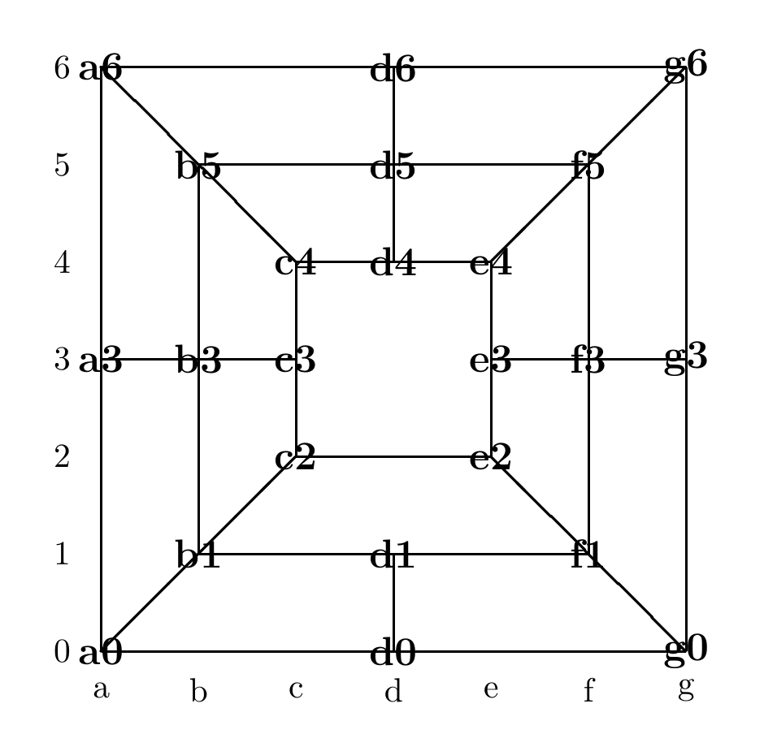

# Morris AI

A game-playing agent for the **Morris Game, Variant**, a version of Nine Men's Morris on a 23-location board. Built for CS4346 (Introduction to Artificial Intelligence) at Texas State University.

The agent chooses moves with **minimax** and **alpha-beta pruning**, scoring positions with a static estimation function. The project has five parts:

1. **Minimax** for the opening and for the midgame/endgame.
2. **Alpha-beta**, which returns the same move as minimax while evaluating fewer positions.
3. **Playing Black** by swapping colors around the White search.
4. **An improved static estimator** that looks at mills, threats, mobility, and blocked pieces, not only material.
5. **A tournament agent** that plays timed matches against other teams' agents.

Python 3.10 or newer. Standard library only.

## Quick start

```bash
python3 -m unittest discover -s tests
python3 programs/MiniMaxOpening.py examples/empty_board.txt out/board.txt 2
python3 programs/TournamentAgent.py
```

The second command picks White's best opening move at depth 2 and prints:

```
Board Position: <23 characters>
Positions evaluated by static estimation: <count>
MINIMAX estimate: <value>
```

The third opens the interactive tournament console.

## The game

<p align="center">
  
</p>

The board has 23 locations. Unlike standard Nine Men's Morris, it has four corner diagonals, no `d2` or `d3`, and an open center. Each player has 9 pieces, and the game has three phases:

- **Opening:** players take turns placing their 9 pieces on empty locations.
- **Midgame:** players take turns sliding one piece along a line to an adjacent empty location.
- **Endgame:** a player with only three pieces may hop to any empty location.

Three pieces of one color on a straight line form a **mill**, including the diagonals. Closing a mill removes one opposing piece that is not in a mill. A player wins by reducing the opponent to two pieces or leaving the opponent with no legal move.

## Board representation

A position is a 23-character string. `W` is a White piece, `B` a Black piece, and `x` an empty location. The string reads left to right, bottom to top, using this index order from the handout:

| Index | 0 | 1 | 2 | 3 | 4 | 5 | 6 | 7 | 8 | 9 | 10 | 11 |
| --- | --- | --- | --- | --- | --- | --- | --- | --- | --- | --- | --- | --- |
| Location | a0 | d0 | g0 | b1 | d1 | f1 | c2 | e2 | a3 | b3 | c3 | e3 |

| Index | 12 | 13 | 14 | 15 | 16 | 17 | 18 | 19 | 20 | 21 | 22 |
| --- | --- | --- | --- | --- | --- | --- | --- | --- | --- | --- | --- |
| Location | f3 | g3 | c4 | d4 | e4 | b5 | d5 | f5 | a6 | d6 | g6 |

For example, `xxxxxBxWWWWWBBBBxxxxxxx` has Black at `f1`, `f3`, `g3`, `c4`, and `d4`, and White at `e2`, `a3`, `b3`, `c3`, and `e3`. [docs/board.md](docs/board.md) lists every location's neighbors and mills.

## Project structure

```
morris/                     game engine (shared by every program)
  board.py                  23 locations, neighbors, mills, color swap
  moves.py                  move generators: placing, sliding, hopping, captures
  estimation.py             original static estimators from the handout
  improved.py               improved static estimators (Part IV)
  search.py                 minimax and alpha-beta
  tournament.py             timed search, match history, interactive console
  cli.py, io.py             command-line handling and board files

programs/                   required entry points, one per assignment program
  MiniMaxOpening.py         White, minimax, opening
  MiniMaxGame.py            White, minimax, midgame/endgame
  ABOpening.py              White, alpha-beta, opening
  ABGame.py                 White, alpha-beta, midgame/endgame
  MiniMaxOpeningBlack.py    Black, minimax, opening
  MiniMaxGameBlack.py       Black, minimax, midgame/endgame
  MiniMaxOpeningImproved.py White, minimax, opening, improved estimator
  MiniMaxGameImproved.py    White, minimax, midgame/endgame, improved estimator
  TournamentAgent.py        match agent for either color and phase

deliverables/               written answers submitted with the code
  Examples.txt              alpha-beta and improved-estimator examples
  MyStaticEstimation.txt    design of the improved estimator

tests/                      unit tests for rules, search, programs, tournament
tools/                      example regeneration and submission ZIP builder
examples/                   sample board files
docs/                       course handouts and project notes
```

Each file in `programs/` is a few lines long. It selects the search, color, phase, and estimator, then calls the shared engine in `morris/`.

## How it works

- **Moves.** `moves.py` follows the handout's pseudocode for White. Black's moves are generated by swapping colors, generating White's moves, and swapping back.
- **Search.** `search.py` has one recursive search. White maximizes and Black minimizes. Alpha-beta is the same search with cutoffs enabled, so both return the same move and value.
- **Estimation.** `estimation.py` keeps the handout's functions unchanged. `improved.py` adds the Part IV functions, explained in `deliverables/MyStaticEstimation.txt`.
- **Tournament.** `tournament.py` runs alpha-beta with iterative deepening inside a time budget, validates every move against the game history, and detects threefold repetition.

[EXPLANATION.md](EXPLANATION.md) walks through each part in detail.

## Documentation

| Document | Contents |
| --- | --- |
| [EXPLANATION.md](EXPLANATION.md) | How the move generator, search, estimators, and tournament agent work |
| [docs/rules.md](docs/rules.md) | Game rules and the handout's move generators |
| [docs/board.md](docs/board.md) | The 23 board locations, neighbors, and mills |
| [docs/programs.md](docs/programs.md) | Required programs, output format, grading, and submission |
| [docs/tournament.md](docs/tournament.md) | Running the tournament agent and the match protocol |
| [CHECKLIST.md](CHECKLIST.md) | Completed work and remaining team tasks |

The original assignment handouts are `docs/Project.pdf` and `docs/Morris-Variant.pdf`.

## Rule interpretation

When a move closes a mill and every opposing piece is already in a mill, the move is kept without a capture. This follows the last line of `GenerateRemove` on page 4 of the Morris Variant handout. The handout's pseudocode is ambiguous here, and this reading has not been confirmed by the instructor.

## Team

| Name | GitHub |
| --- | --- |
| Amul Paudel | [@amul-byte](https://github.com/amul-byte) |
| Gaurab Chhetri | [@gaurabfs-14](https://github.com/gaurabfs-14) |
| Samar Ranjit | [@samarranjit](https://github.com/samarranjit) |
